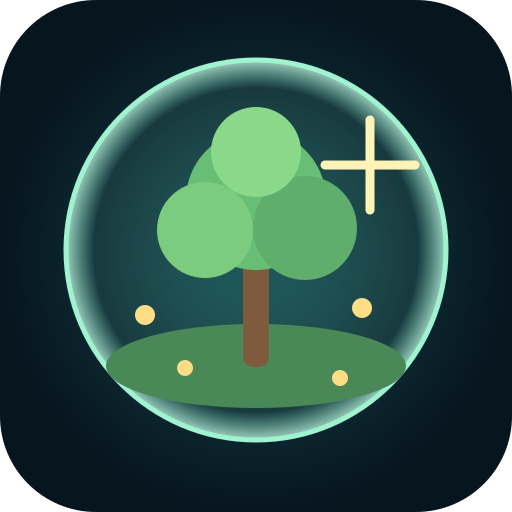

# Faewood · Fairy Sanctuary

A tiny forest inside a giant magical bubble. Fly around as a fairy, gather forest treasures, and build your own expandable treehouse — designed first for Android phones, with full keyboard/mouse support.



## Play

- **GitHub Pages:** https://drecosta.github.io/faewood/
- **Locally:** `npm start`, then visit `http://localhost:8080`.
- No build step, no CDN: Three.js is vendored in `vendor/` and the game works offline as an installable PWA.

## Controls

| Mobile | PC |
| --- | --- |
| Left stick — walk / run (push fully) | WASD / arrows, Shift to run |
| Drag anywhere on the world — rotate camera | Drag with mouse, wheel to zoom |
| **FLY** hold — ascend / fly, tap — jump, double-tap — toggle hover | Space hold = fly, tap = jump, F = hover toggle |
| **TAKE** — harvest a nearby glowing resource | E |
| **BAG** — inventory & character | I |
| **BUILD** — building menu | B |
| Build bar — rotate, raise/lower, snap, move, remove, place | Q/R rotate, T snap, Delete remove, Enter place |

Pinch to zoom on mobile.

## Gameplay

- Explore hills, a pond, a stream, a waterfall, a crystal cave and the canopy of the ancient tree.
- Harvest nine resources (wood, leaves, flowers, mushrooms, stones, crystals, seeds, fairy dust and rare star dew). Nodes visually glow when you are close and respawn over time.
- Craft planks, rope, glass, lanterns, cushions and bottled fairy dust.
- Build with 28 pieces across five categories: decks, walls, windows, roofs, ladders, stairs, rope bridges, balconies, furniture, lanterns and decorations.
- Building features a live ghost preview, grid snapping or free placement, 90° rotation, half-unit vertical adjustment, surface snapping onto existing pieces, 50%-refund removal, and repositioning of placed pieces.
- Flight consumes energy which regenerates on the ground. Falling from high up costs glow.
- Customise skin, hair, dress and wing glow.
- Day/night cycle with stars, fireflies, and dynamic lighting.
- Everything (player, inventory, harvest timers, every built piece, settings and style) saves automatically to localStorage. Menu → Save now / Load last save / Start over.

## Performance

Mobile-first rendering: instanced vegetation, low-poly stylised geometry, capped pixel ratio, optional 512–1536px shadow maps, no post-processing, lightweight shaders, fog culling, and Low / Medium / High graphics settings. The PWA service worker caches the whole game for offline play.

## Project layout

```
src/
  core/     engine, input, save, audio, math helpers
  world/    terrain, water, bubble, instanced vegetation, heightfield
  player/   fairy model + animation, movement/camera controller
  systems/  items & recipes, inventory, harvesting, building
  ui/       HUD, panels, touch controls feedback
vendor/     Three.js r187 (offline)
tools/      local dev server and icon generator
```

Made with Three.js. No textures or audio files required — ambience is synthesised with WebAudio and all visuals are procedural.
